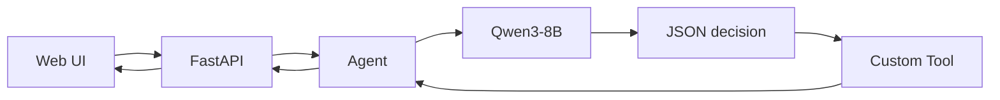

# GPU 기반 오픈소스 LLM·AI Agent 서비스 개발 특강 — 학습 기록

2026년 11월 특강 실습을 회차별로 정리한 문서입니다. 개인 취업 프로젝트와 별도로 관리하며, 강의 제공 코드 기반의 실습과 최종 응용 프로젝트를 구분합니다.

- 최종 PBL: [FinanceRAG](../README.md)
- 실습 환경: RunPod, NVIDIA A100 80GB PCIe, Jupyter Notebook, Python, PyTorch, Hugging Face Transformers
- 기록 근거: 첨부된 1~5회차 노트북의 저장된 출력 및 `yu-gpu-ai.zip`의 결과 CSV. 6~7회차는 기존 FinanceRAG 제출본 설명을 기준으로 정리했습니다.
- 강의 원본 노트북과 배포 소스는 재배포 허용 여부가 확인되지 않아 이 학습 기록에 복제하지 않았습니다. 수치는 첨부 파일에 저장된 실습값이며 이번 문서 작성 시 GPU를 재실행한 값은 아닙니다.

## 회차별 학습 흐름

| 회차 | 실습 내용 | 핵심 기술 |
| --- | --- | --- |
| 1 | GPU에서 Qwen과 Gemma 실행 및 비교 | CUDA, BF16, NF4, VRAM |
| 2 | LLM 성능 평가 및 모델 선정 | Latency, Tokens/sec, JSON 검증 |
| 3 | Custom Tool과 AI Agent 구현 | AST, Tool Registry, JSON decision |
| 4 | AI Agent REST API 서비스 | FastAPI, Pydantic, Uvicorn |
| 5 | 웹 서비스 MVP 및 기능 평가 | HTML, CSS, JavaScript, API 연동 |
| 6 | 문서 기반 검색·생성 | RAG, 청크, 임베딩, 하이브리드 검색 |
| 7 | LoRA 연결 및 최종 서비스 통합 | PEFT, adapter, FinanceRAG |

## 1회차 — GPU 기반 LLM 실행 및 성능 비교

자료: `01_GPU_LLM_Qwen_Gemma.ipynb`, `01_LLM_GPU_Comparison.csv`.

동일 질문으로 Qwen3-8B의 BF16 및 NF4 4-bit, Gemma 3 4B IT의 BF16 추론을 비교했습니다. Qwen은 AutoTokenizer, Gemma는 AutoProcessor와 모델별 채팅 템플릿을 사용합니다. 각 실험 사이 모델 객체와 GPU 캐시를 정리합니다.

| 모델 | 정밀도 | 생성 토큰 | 시간(s) | tokens/s | Peak VRAM(GB) |
| --- | --- | ---: | ---: | ---: | ---: |
| Qwen3-8B | BF16 | 90 | 4.168 | 21.59 | 15.28 |
| Qwen3-8B | NF4 4-bit | 145 | 21.051 | 6.89 | 5.78 |
| Gemma-3-4B-IT | BF16 | 137 | 7.324 | 18.71 | 8.04 |

NF4는 이번 실험에서 Qwen의 GPU 메모리 사용량을 낮췄지만 처리 속도는 BF16보다 낮았습니다. 양자화가 항상 추론 가속으로 이어지는 것은 아닙니다. 모델별 토크나이저와 생성 길이가 다르며 단일 질문 결과이므로 일반적인 모델 우열로 해석하지 않습니다. Peak VRAM은 PyTorch의 추론 중 최대 할당량입니다.

## 2회차 — LLM 평가와 모델 선정

자료: `02_Model_Evaluation.ipynb`, `02_model_evaluation_results.csv`, `02_model_selection_summary.csv`.

설명, 요약, 지시 준수, 구조화 출력, 분류의 5문항을 두 BF16 모델에서 비교했습니다. Qwen Thinking은 비활성화한 평가입니다.

| 모델 | 평균 응답 시간(s) | 평균 tokens/s | 평균 Peak VRAM(GB) | 형식 준수율 |
| --- | ---: | ---: | ---: | ---: |
| Gemma-3-4B-IT | 5.23 | 19.31 | 8.04 | 80% |
| Qwen3-8B | 2.39 | 30.48 | 15.28 | 80% |

두 모델 모두 단일 JSON 객체를 요구한 문항에서 raw JSON 검증에 실패했습니다. Gemma는 코드펜스와 미완성 배열을, Qwen은 연속된 두 객체를 출력했습니다. 코드펜스를 제거한 후에도 두 결과 모두 유효하지 않았습니다.

이번 실험에서는 Qwen의 응답 속도가 더 높았고 Gemma의 메모리 사용량은 더 낮았습니다. 이후 3~5회차 Agent는 Qwen3-8B를 사용합니다. 형식 준수율은 규칙 기반 지표로 정답 정확도나 금융 분석 품질을 의미하지 않습니다.

## 3회차 — Custom Tool과 AI Agent

자료: `03_Custom_Tool_Agent.ipynb`, `03_agent_tool_execution_log.csv`.

| Tool | 기능 |
| --- | --- |
| calculator | AST 기반 허용 연산 계산 |
| text_length | 문자열 길이 |
| current_time | 한국 표준시 |
| data_summary | 개수, 합계, 평균, 최솟값, 최댓값 |

사용자 질문 → Qwen의 JSON 판단 → 파싱·인자 검증 → 등록된 Tool 실행 또는 직접 답변 → 최종 응답.

계산기는 Python eval을 사용하지 않고 허용된 AST 연산만 처리합니다. 미등록 도구와 허용되지 않은 수식에 대한 오류 처리를 실습했습니다.

| 질문 유형 | 결과 | Tool | 시간(ms) |
| --- | --- | --- | ---: |
| 계산 | 성공 | calculator | 1633.8 |
| 글자 수 | 성공 | text_length | 1114.0 |
| 한국 시간 | 실패 | 미선택 | 551.2 |
| 판매액 통계 | 성공 | data_summary | 1504.6 |
| 일반 설명 | 성공 | 직접 답변 | 1791.4 |

한국 시간 질문에서 JSON 문자열이 끝나지 않아 파싱에 실패했습니다. 시간 함수 자체는 별도 단위 테스트에서 정상 값을 반환했습니다. Tool 구현과 LLM의 도구 선택은 별도로 검증해야 한다는 점을 확인할 수 있습니다.

## 4회차 — FastAPI Agent 서비스

자료: `04_FastAPI_Agent_Service.ipynb`, 압축파일의 `04_agent_web_mvp/`.

3회차의 도구 및 Agent를 REST API로 분리했습니다.

| 파일 | 역할 |
| --- | --- |
| app/tools.py | Custom Tool 및 Registry |
| app/llm.py | Qwen 로딩 및 생성 |
| app/agent.py | JSON 판단 및 Tool 실행 |
| app/main.py | FastAPI 라우트 및 요청 검증 |

API는 GET /, GET /health, GET /tools, POST /agent를 제공합니다. 모델은 필요할 때 로드하며 CPU 환경에서도 기본 상태 확인이 가능합니다.

저장된 TestClient 출력: /, /health, /tools, /docs 모두 HTTP 200, 빈 요청 HTTP 422. Python 문법 검사와 계산·통계 Tool 단위 테스트도 통과했습니다. GPU 없는 환경의 /agent는 503으로 처리하도록 구현되어 있습니다. 이 회차의 저장 출력에서는 별도의 실제 GPU HTTP 호출 성능값을 확인하지 않았습니다.

## 5회차 — AI Agent Web Service MVP

자료: `05_AI_Agent_Web_MVP.ipynb`, 압축파일의 `05_agent_web_mvp/`.

4회차 API에 HTML, CSS, JavaScript 웹 UI를 연결했습니다. JavaScript fetch로 /agent에 질문을 보내고 답변, Tool 정보, 오류, 처리 시간을 표시합니다.

저장된 노트북 출력에서 정적 파일, /health, /tools 등은 HTTP 200을 반환했습니다. GPU 기능 평가 표는 다음과 같습니다.

| 유형 | 성공 여부 | HTTP | 처리 시간(ms) |
| --- | --- | ---: | ---: |
| 계산 | 성공 | 200 | 26913.3 |
| 글자 수 | 성공 | 200 | 654.6 |
| 현재 시간 | 실패 | 200 | 307.1 |
| 데이터 분석 | 성공 | 200 | 1109.6 |
| 일반 설명 | 성공 | 200 | 583.5 |
| 빈 입력 거부 | 성공 | 422 | — |

정상 질문 5개 중 4개 성공, 오류 입력 1개는 예상대로 거부되었습니다. HTTP 200만으로 Agent의 성공 여부를 판단하면 안 됩니다. 첫 계산 요청은 다른 요청보다 오래 걸렸으나 정확한 원인별 시간은 기록되어 있지 않습니다. 5회차 결과는 노트북에 저장된 표를 옮긴 것이며 해당 CSV 원본은 제공된 압축파일에 없었습니다.

## 6~7회차 — RAG와 LoRA, 최종 PBL

이 부분은 1~5회차 실습 자료와 달리 이번 첨부에 원본 노트북이 없어 [FinanceRAG 제출본 README](../README.md)에서 확인되는 내용만 기록합니다.

- RAG: 문서 청크를 색인하고 질문과 관련된 자료를 하이브리드 검색으로 선택하여 LLM에 전달.
- LoRA: 강의 환경에서 저장한 호환 어댑터를 선택적으로 연결하고 동일 검색 결과에 대한 생성 결과를 비교.
- FinanceRAG: 삼성전자 2024년 2·3분기 공식 실적 자료를 바탕으로 재무 질의, 근거 문단, 공식 출처 링크, 응답 시간 등을 제공하는 챗봇.
- CPU 모드에서는 TF-IDF 검색을 활용하며 GPU 모드와 구분합니다.
- 제출본의 GPU 생성 품질, LoRA 전후 성능 및 추론 속도는 별도 검증이 필요합니다. 금융 특화 LoRA를 새로 학습했다는 기록은 없습니다.

## 학습 정리 및 개선 과제

- 모델 선정에서는 메모리·속도뿐 아니라 구조화 출력의 안정성을 확인해야 합니다.
- Agent는 LLM의 결정과 Python 실행을 분리하고, 허용 목록과 인자 검증으로 안전성을 높입니다.
- 3회차와 5회차에서 실패한 시간 질문은 추후 JSON 출력 규약과 오류 처리 개선을 비교하기 좋은 사례입니다. 개선 후 재측정값은 아직 이 기록에 없습니다.
- 웹 서비스의 HTTP 응답, 실제 기능 성공, 답변 정확도는 별도로 검증해야 합니다.
- 강의 예제와 최종 응용 결과물은 [프로젝트 README](../README.md)에서 구분합니다.

## 관련 링크

- [Qwen3-8B 모델](https://huggingface.co/Qwen/Qwen3-8B)
- [Gemma 3 4B IT 모델](https://huggingface.co/google/gemma-3-4b-it)
- [최종 PBL 실행 방법 및 구현 범위](../README.md)
